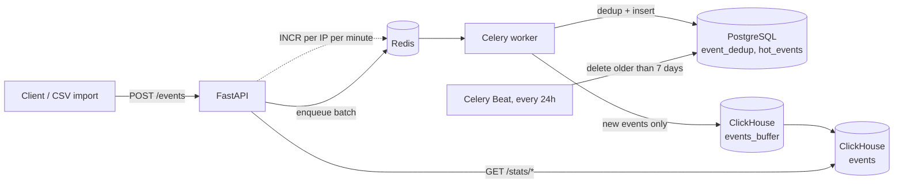

<div align="center">


**Idempotent event ingestion and product analytics, backed by PostgreSQL (hot) and ClickHouse (cold).**


</div>

## Overview

A service that accepts batches of user events over HTTP, deduplicates them, and serves product analytics (DAU, top events, weekly retention). Writes are acknowledged immediately and processed asynchronously; deduplication lives in PostgreSQL, history lives in ClickHouse. Design rationale is recorded in [`ADR.md`](ADR.md) and [`LEARNED.md`](LEARNED.md) (both in Ukrainian).

## Highlights

- **Fast ack, async write.** `POST /events` validates the batch with Pydantic, enqueues it to Celery over Redis and returns `202 Accepted`.
- **Idempotent by `event_id`.** Workers check and insert into a PostgreSQL `event_dedup` table (`ON CONFLICT DO NOTHING`), so a replayed event is stored once.
- **Idempotent CSV import.** `import_events.py` derives a batch key from `sha256(path:size:mtime)` per 1000-event chunk and records it in `batch_dedup`.
- **Hot/cold split.** PostgreSQL keeps `hot_events`, pruned to a 7-day window by a Celery Beat job; ClickHouse keeps the full history in a monthly-partitioned `MergeTree`.
- **Buffered ClickHouse inserts.** Workers write through a `Buffer` table in front of `events`, which batches small inserts.
- **Operability.** Per-IP rate limiting on `/events` (Redis), structured JSON logs (structlog), Prometheus `/metrics`, late-ack Celery tasks.

## Architecture



| Component | Role |
|---|---|
| FastAPI (`app/main.py`) | HTTP API, rate-limit and logging middleware, `/metrics`, `/health` |
| Redis | Celery broker and result backend (db 0 / 1), rate-limit counters |
| Celery worker (`app/tasks/workers.py`) | Dedup, write to PostgreSQL, forward new events to ClickHouse |
| Celery Beat | Schedules `cleanup_hot_events` every 86400 s |
| PostgreSQL | `event_dedup`, `batch_dedup`, `hot_events` (indexed on `occurred_at`, `user_id`) |
| ClickHouse | `events` (`MergeTree`, `PARTITION BY toYYYYMM(occurred_at)`) and `events_buffer` |
| Prometheus / Grafana | Prometheus scrapes `api:8000`; Grafana ships without provisioned dashboards |

All `/stats/*` queries read from ClickHouse; the PostgreSQL hot layer is not queried by the API.

## API

| Method | Path | Notes |
|---|---|---|
| POST | `/events` | Body `{"events": [{event_id (UUID), occurred_at, user_id, event_type, properties}]}`. Returns `202` `{"status": "accepted", "count": N}`; `429` when rate limited |
| GET | `/stats/dau` | `from`, `to` (`YYYY-MM-DD`), optional `segment=event_type:<v>` or `segment=properties.<key>:<v>` |
| GET | `/stats/top-events` | `from`, `to`, `limit` (1-100, default 10) |
| GET | `/stats/retention` | `start_date`, `windows` (1-12, default 3); returns `week_0` count and `week_1..week_3` percentages |
| GET | `/health` | Liveness |
| GET | `/metrics` | Prometheus exposition |

Interactive docs are served at `/docs`.

## Tech stack

| Layer | Technology |
|---|---|
| API | FastAPI 0.109, Pydantic 2, Uvicorn |
| Async work | Celery 5.3 (Redis broker, `acks_late`, JSON serializer) |
| Hot storage | PostgreSQL 16, SQLAlchemy 2 (asyncpg), Alembic migrations |
| Cold storage | ClickHouse (`clickhouse-connect`) |
| Observability | structlog, prometheus-client, Prometheus, Grafana |
| Tooling | Docker Compose, pytest, pytest-asyncio, httpx |

## Quick start

`docker-compose.yml` loads a `.env` file that is not in the repo (it is git-ignored). Create one pointing at the compose service names:

```bash
POSTGRES_HOST=postgres
CLICKHOUSE_HOST=clickhouse
REDIS_HOST=redis
CELERY_BROKER_URL=redis://redis:6379/0
CELERY_RESULT_BACKEND=redis://redis:6379/1
```

Then:

```bash
docker-compose up --build
```

| Service | URL |
|---|---|
| API | http://localhost:8000 (Swagger at `/docs`) |
| Prometheus | http://localhost:9090 |
| Grafana | http://localhost:3000 |

Import a CSV (columns `event_id, occurred_at, user_id, event_type, properties_json`; `*.csv` and `data/` are git-ignored, so supply your own file):

```bash
docker-compose exec api python import_events.py /app/data/events.csv
```

## Configuration

Read by `app/config.py` (pydantic-settings, `.env` supported). The compose file also sets development credentials for the database containers.

| Variable | Default |
|---|---|
| `POSTGRES_HOST` / `POSTGRES_PORT` | `localhost` / `5432` |
| `POSTGRES_DB` / `POSTGRES_USER` / `POSTGRES_PASSWORD` | `events_db` / `postgres` / development default |
| `CLICKHOUSE_HOST` / `CLICKHOUSE_PORT` | `localhost` / `8123` |
| `CLICKHOUSE_DB` / `CLICKHOUSE_USER` / `CLICKHOUSE_PASSWORD` | `analytics` / `default` / development default |
| `REDIS_HOST` / `REDIS_PORT` | `localhost` / `6379` |
| `CELERY_BROKER_URL` / `CELERY_RESULT_BACKEND` | `redis://localhost:6379/0` / `redis://localhost:6379/1` |
| `RATE_LIMIT_PER_MINUTE` | `1000` (per client IP, `/events` only) |

## Project structure

```
app/
  api/          events.py, stats.py
  db/           postgres.py, clickhouse.py, redis_client.py
  middleware/   rate_limit.py, logging.py
  models/       Pydantic schemas
  tasks/        celery_app.py, workers.py
alembic/        migrations (initial tables, timezone-aware datetimes)
tests/          conftest.py, test_idempotency.py, test_integration.py
import_events.py   idempotent CSV importer
docker-compose.yml, Dockerfile, prometheus.yml
ADR.md, LEARNED.md
```

## Testing

```bash
docker-compose exec api pytest -v
```

`tests/test_idempotency.py` posts the same event twice and asserts a single row in ClickHouse. The tests need live PostgreSQL, ClickHouse and Redis plus a running worker, and use fixed sleeps to wait for the buffer flush. The rate-limit test is commented out. `tests/test_integration.py` is currently broken (see below).

## Status and roadmap

Working prototype, not production-hardened. Known gaps:

- **No benchmark in the repo.** The previous README quoted throughput and latency figures, but no benchmark script or test backs them, so they were removed.
- **Segment filter and date params are interpolated into ClickHouse SQL.** Dates are regex-validated; the `segment` value is not escaped. Needs parameterized queries before any exposure.
- **Rate limiting** is a fixed-window counter per IP per minute (not a token bucket) and covers only `POST /events`.
- **Metrics:** only `events_received_total`, `events_failed_total` and `events_processing_seconds` are declared, and the histogram is never observed.
- **Retention** is computed for fixed week offsets 1-3; `windows` only limits the number of cohorts returned.
- **Tests:** `test_integration.py` sends a bare list instead of `{"events": [...]}` and requests a non-existent `setup_database` fixture.
- **Schema** is created at startup via `create_all`; the Alembic migrations are not wired into the startup path.
- Next: parameterized ClickHouse queries, hot-layer reads, Grafana dashboards, a reproducible benchmark.
